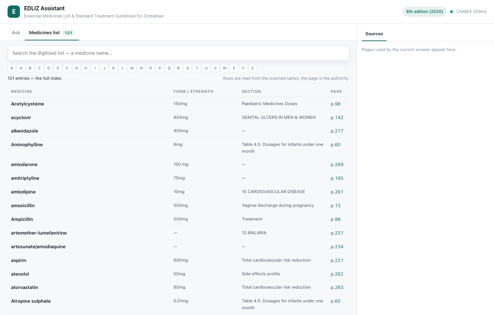

# EDLIZ Assistant

A working answer to *Assignment 1: develop an application (a large language
model) for the digitalisation of EDLIZ 2025* — with one honest caveat up front:
**the corpus currently loaded is the 8th edition (2020)**, because the 9th
edition (2025) PDF could not be downloaded from any public source. The
pipeline is edition-agnostic; see [Switching to the 2025 edition](#switching-to-the-2025-edition-9th-edition).



<p align="center"><em>The digitised list: every row carries strength, section and the page it was read from.</em></p>

---

## What it does

Three things, in order of what the assignment asks for:

1. **Digitalises the book.** A scanned PDF becomes per-page text (OCR), then
   searchable passages, then a **browsable medicines list on the main screen** —
   every entry carries the strength and the page it came from, and clicking a
   row opens the page it was read from.
2. **Answers questions from it (RAG).** A question is embedded, matched against
   the book by both vector similarity and keyword search, and answered by a
   model that may only use the passages it was shown. Every clinical claim ends
   in a page citation — `[p.135]` — which opens the source page.
3. **Goes to the internet when the book cannot answer.** DuckDuckGo, Wikipedia,
   PubMed and the US FDA label database are exposed as tools, and answers that
   use them say which source they used and that it is not Zimbabwean guidance.

```
question ──▶ retrieve (vector + keyword, fused) ──▶ model with tool loop ──▶ streamed answer
                     │                                    │
              page-tagged passages                 search_edliz, lookup_medicine,
                                                   web_search, pubmed, us_drug_label, fetch_page
```

## The screens

Two views share the main column, switchable at the top and deep-linkable
(`/#ask`, `/#list`):

- **Ask** — the chat, with sources in the right panel. Every `[p.N]` opens the
  page text.
- **Medicines list** — the digitised index full-width: search, A–Z, and a
  table of name, form/strength, section and page. Clicking a row opens the rows
  and page excerpts for that medicine, so a name always leads back to the book.

The section column shows a chapter (e.g. *15 CARDIOVASCULAR DISEASE*) where the
book's chapter dividers are legible to OCR, and otherwise the page's own header
(e.g. *Paediatric Medicines Doses*). Roughly a third of rows show `—` because
neither could be established; a blank is preferred to a guess.

## Why the design looks like this

- **Retrieval runs before the model, always.** Even if the model decides to call
  no tools, it has already been handed the best passages. An answer cannot be
  written from memory.
- **Hybrid search, fused by rank, not by score.** `bge-m3` understands
  "treatment for a discharge" but is weak on drug names; full-text search is the
  reverse. Reciprocal-rank fusion keeps whatever both agree on.
- **Fusion beats normalisation.** Vector cosine and BM25 are not on a comparable
  scale, so averaging them hides information. Ranks are comparable.
- **The model never writes a dose it was not shown.** The prompt forbids
  rounding, converting or repairing a dose, and tells it to point at the page
  when OCR text looks garbled instead of guessing.
- **Web content is fenced off.** It may never stand in for the national
  guideline on a dosing decision; the prompt fixes that and the UI labels it.

## Quick start

```bash
uv venv .venv                                  # Python 3.11+
uv pip install --python .venv/bin/python -e .

cp .env.example .env                           # then set CAIMEX_API_KEY

# 1. Chunk, embed, and build the medicines index (~15-45 s)
#    The OCR text for the 2020 edition ships with the repo, so no OCR is
#    needed for a first run.
.venv/bin/python -m app.ingest --text data/text/edliz-2020 --edition "8th edition (2020)"

# 2. Run
.venv/bin/uvicorn app.server:app --port 8077
# open http://127.0.0.1:8077
```

**What is and is not in this repo.** The 273 OCR page files (`data/text/`,
about 1 MB) are tracked, so the app runs without poppler or tesseract. The
43 MB scanned PDF and the SQLite index are not tracked — the index is rebuilt
by the command above. To redo the OCR from scratch, fetch the PDF and run
`scripts/ocr_pdf.py` (it is resumable and parallel, and writes one
`page-NNNN.txt` per page):

```bash
.venv/bin/python scripts/ocr_pdf.py data/EDLIZ-2020.pdf --out data/text/edliz-2020
```

## Running it without Econet access

`CAIMEX_*` is just *an OpenAI-compatible endpoint plus a key*. Anything that
speaks `/v1/chat/completions` and `/v1/embeddings` works — an OpenRouter key, a
local Ollama, or LM Studio:

```bash
# Ollama, entirely local and free
CAIMEX_BASE_URL=http://127.0.0.1:11434/v1
CAIMEX_API_KEY=ollama
EDLIZ_CHAT_MODEL=qwen3:8b
EDLIZ_EMBED_MODEL=bge-m3
```

One caveat: the chat model must support tool calling, because retrieval and the
web tools are driven through `tool_calls`. If it does not, answers degrade to a
single retrieval pass — still grounded and cited, but without the tool loop.

## Switching to the 2025 edition (9th edition)

```bash
# put the file at data/EDLIZ-2025.pdf, then:
.venv/bin/python scripts/ocr_pdf.py data/EDLIZ-2025.pdf --out data/text/edliz-2025
EDLIZ_TEXT_DIR=data/text/edliz-2025 .venv/bin/python -m app.ingest \
    --text data/text/edliz-2025 --edition "9th edition (2025)"
```

Then set `EDLIZ_EDITION=9th edition (2025)` in `.env` and restart. If the new
PDF has a real text layer, add `--text-layer` to the OCR step to skip OCR
entirely — it is faster and exact.

The UI shows a warning band if the ingested edition and the configured edition
disagree, so a stale corpus cannot be mistaken for a fresh one.

## Configuration

| Variable | Default | Notes |
| --- | --- | --- |
| `CAIMEX_BASE_URL` | `https://caimex.econetai.co.zw:2052/v1` | Internal OpenAI-compatible gateway |
| `CAIMEX_API_KEY` | — | Required |
| `EDLIZ_CHAT_MODEL` | `deepseek-v4-flash` | Fastest model on the gateway that actually returns `tool_calls` |
| `EDLIZ_EMBED_MODEL` | `bge-m3` | 1024-dim, multilingual, good on clinical text |
| `EDLIZ_EDITION` | `8th edition (2020)` | Shown in the UI; warns on mismatch |
| `EDLIZ_WEB_SEARCH` | `1` | `0` makes the assistant corpus-only |
| `EDLIZ_TOP_K` | `8` | Passages retrieved per question |

### The proxy trap

The CAIMEX client sets `trust_env=False` on purpose. The macOS bypass list
names `econetai.local` but **not** `econetai.co.zw`, which is where the gateway
lives — a proxy-aware HTTP client either hangs or receives a proxy error page.
The web tools do the opposite (`trust_env=True`): external hosts may use the
corporate proxy.

## API

| Endpoint | Purpose |
| --- | --- |
| `GET /api/status` | corpus, edition, gateway health, model names |
| `POST /api/ask` | SSE stream: `step`, `token`, `done`, `error` events |
| `GET /api/medicines?q=&letter=` | digitised index, search or A–Z |
| `GET /api/medicine?name=` | rows, pages and page excerpts for one medicine |
| `GET /api/page/{n}` | full OCR text of a page |
| `GET /api/search?q=` | raw retrieval hits, for debugging relevance |

## Verified behaviour

Run on this machine, against the 2020 corpus:

- *"What is the first-line treatment for gonorrhoea?"* → ceftriaxone 250 mg IM
  single dose, citing `[p.135]`, `[p.136]`, `[p.138]`; it also flagged its own
  OCR garble of the kanamycin row rather than repairing it.
- *"What is the WHO dose today? My corpus is from 2020."* → said EDLIZ 2020 does
  not cover WHO guidance, quoted the 2020 pages anyway, and offered Wikipedia
  `[W3]` explicitly marked as a US CDC figure, not Zimbabwean guidance.
- *"A 3-year-old has severe malaria..."* → led with the emergency action
  (parenteral artesunate before referral, `[p.236]`), named the level of care,
  and refused to read a number off the badly OCR'd weight-band table — pointing
  at the printed page instead.
- Retrieval and the medicines index were checked directly through `/api/search`
  and `/api/medicines`.
- Latency: ~2 s for retrieval plus a 2–4 round tool loop, ~10–15 s to a finished
  streamed answer.
- `pytest tests -q` → 14 passed.

## Limitations (read these before demonstrating it)

- **The corpus is 2020, not 2025.** This is the one gap that matters. Everything
  else is ready for the 2025 text.
- **OCR is good on prose, approximate on tables.** Column structure is lost, so
  `iv/sc` can arrive as `ivic` and a two-column table becomes one long line.
  Doses are usually legible but the page is the authority, and the assistant is
  instructed to say so.
- **The medicines index is heuristic.** It finds rows, not a curated
  formulary: ~230 rows, 125 distinct names in the 2020 edition, with roughly a
  5% residue of junk entries (`Payt`, `contraceptive`). It is for navigation to
  a page, not a data source in its own right.
- **General web search is best-effort.** DuckDuckGo starts answering HTTP 202
  from this network after a few requests, so the fallback is Wikipedia, which is
  an encyclopaedia rather than a search engine. PubMed and openFDA are stable
  and need no key.
- **Single-node, single-user.** SQLite, in-process vector search, no auth. Fine
  for a laptop demonstration; not a deployment.

## Safety framing

This is decision support for trained health workers, not a prescriber. The UI
states it, the prompt enforces it, and an answer with no page citation is
treated as a failure of the design rather than an answer.

## Layout

```
app/
  config.py     settings, .env
  caimex.py     gateway client (embeddings, chat, streaming, health)
  textproc.py   OCR normalisation, chunking, section detection
  medicines.py  digitised medicines index
  db.py         SQLite schema and vector storage
  ingest.py     PDF text -> pages -> chunks -> embeddings -> index
  retrieval.py  hybrid search and rank fusion
  tools.py      web, Wikipedia, PubMed, openFDA
  agent.py      prompt, tool loop, streamed synthesis
  server.py     FastAPI + static UI
web/            index.html, style.css, app.js (no build step)
scripts/
  ocr_pdf.py    scanned PDF -> per-page text (pdftoppm + tesseract)
tests/
  test_offline.py   unit tests that need no network
```
