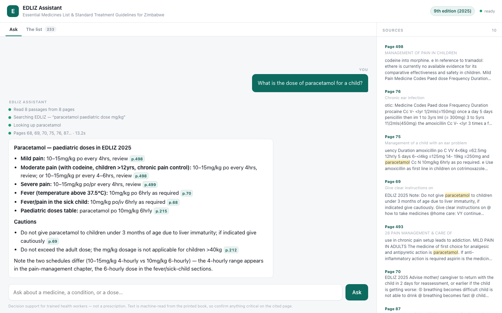

# EDLIZ Assistant

A working application for *Assignment 1: develop an application (a large language
model) for the digitalisation of EDLIZ 2025*.

It reads the 9th edition of Zimbabwe's Essential Medicines List and Standard
Treatment Guidelines — **673 pages, scanned and digitised** — and answers
questions from it. Every clinical claim carries the page it came from, and
clicking that page opens the text it was read from.


<p align="center"><em>The digitised list: 229 medicines, each row carrying its strength, section and source page.</em></p>

---

## What it does

1. **Digitalises the book.** A scanned PDF becomes per-page text (OCR), then
   searchable passages, then a browsable medicines list where every row keeps
   the page it came from. 673 pages → 1,322 passages → 229 medicines.
2. **Answers from it.** A question is matched against the book by both vector
   similarity and full-text search; the model may only use the passages it was
   shown, and *may not* answer from memory. Every claim ends in a `[p.130]`
   citation.
3. **Goes to the internet when the book cannot.** DuckDuckGo, Wikipedia, PubMed
   and the US FDA label database are tools, and any answer using them says which
   source it used and that it is not Zimbabwean guidance.

```
question ──▶ retrieve (vector + keyword, fused) ──▶ model with tool loop ──▶ streamed answer
                     │                                    │
              page-tagged passages                 search_edliz, lookup_medicine,
                                                   web_search, pubmed, us_drug_label, fetch_page
```

## The screens

Two views share the main column, deep-linkable as `/#ask` and `/#list`.

**The list** is the front door for lookups.

- One search box. Typing `ceftri` answers with medicines; typing
  `gonorrhoea` answers with passages from the guideline; typing
  `ceftriaxone for gonorrhoea` answers with both. There is no mode to choose
  before you start typing.
- Matches are highlighted, and the section each row lives in is shown where the
  book makes it legible.
- Clicking any row or passage opens the page itself, with the searched words
  highlighted inside the page text.

**Ask** is the conversation, for questions rather than lookups.



- Answers stream in; the steps above each answer show what was searched.
- Citations are the primary affordance — `[p.130]` opens page 130.
- The right-hand panel lists every page behind the answer.

### Keyboard

| Key | Action |
| --- | --- |
| `/` | jump to search from anywhere |
| `↑` `↓` | move through results |
| `Enter` | open the focused result |
| `Esc` | close the page drawer, then clear the search |
| `←` `→` | previous/next page while the drawer is open |
| `Enter` | send a question (`Shift+Enter` for a new line) |

## Why the design looks like this

- **One place to type.** The first version had "Ask" and "list" as separate
  modes, so a clinician had to decide what kind of question they had before
  typing it. Search now answers both interpretations of the same keystrokes.
- **Retrieval runs before the model, always.** Even if the model calls no
  tools, it has already been handed the best passages, so an answer cannot be
  written from memory.
- **Hybrid search, fused by rank rather than score.** `bge-m3` understands
  "treatment for a discharge" but is weak on drug names; full-text search is the
  reverse. Reciprocal-rank fusion keeps whatever both agree on. Cosine and BM25
  are not on a comparable scale, so averaging them would hide information.
- **The model never writes a dose it was not shown.** The prompt forbids
  rounding, converting or repairing a dose, and tells it to point at the page
  when the OCR looks garbled instead of guessing.
- **Provenance is the product.** A page citation you can open, with your search
  terms visible in the text, is what makes an answer checkable. That is why the
  drawer, not the chat bubble, is the most important screen.

## Quick start

```bash
uv venv .venv                                  # Python 3.11+
uv pip install --python .venv/bin/python -e .

cp .env.example .env                           # then set CAIMEX_API_KEY

# 1. Chunk, embed, and build the medicines index (~20 s)
.venv/bin/python -m app.ingest --text data/text/edliz-2025 --edition "9th edition (2025)"

# 2. Run
.venv/bin/uvicorn app.server:app --port 8077
# open http://127.0.0.1:8077
```

**What is and is not in this repo.** The OCR text for the 2025 edition is
tracked (`data/text/edliz-2025`, 673 files), so the app runs without poppler or
tesseract. The source PDF and the SQLite index are not tracked; the index is
rebuilt by the command above. The 8th edition (2020) OCR text is also included, so you can switch
editions and compare without fetching anything.

## Running it without Econet access

`CAIMEX_*` is just *an OpenAI-compatible endpoint plus a key*. Anything that
speaks `/v1/chat/completions` and `/v1/embeddings` works — an OpenRouter key, a
local Ollama, or LM Studio:

```bash
# Ollama, entirely local and free
CAIMEX_BASE_URL=http://127.0.0.1:11434/v1
CAIMEX_API_KEY=ollama
EDLIZ_CHAT_MODEL=qwen3:8b
EDLIZ_EMBED_MODEL=bge-m3
```

The chat model must support tool calling, because the tool loop is driven
through `tool_calls`. Without it, answers degrade to a single retrieval pass:
still grounded and cited, but without the extra searches.

## Switching or adding an edition

`data/text/` holds one directory per edition. Ingest points the app at one:

```bash
# the 8th edition, for comparison
.venv/bin/python -m app.ingest --text data/text/edliz-2020 --edition "8th edition (2020)"

# back to 2025
.venv/bin/python -m app.ingest --text data/text/edliz-2025 --edition "9th edition (2025)"
```

Then set `EDLIZ_EDITION` and `EDLIZ_TEXT_DIR` in `.env` to match. If they
disagree with the loaded corpus, the UI shows a warning band — a stale corpus
cannot be mistaken for a fresh one.

To digitise one more edition from a scan:

```bash
.venv/bin/python scripts/ocr_pdf.py data/EDLIZ-2025.pdf --out data/text/edliz-2025
```

The OCR step is resumable and parallel (673 pages in about 90 seconds on 8
workers). Add `--text-layer` for a PDF that carries usable text; the 2025 soft
copy does not, because its font encoding is shifted — `:H ZRXOG` decodes to
"We would" — so OCR is the reliable route.

## Configuration

| Variable | Default | Notes |
| --- | --- | --- |
| `CAIMEX_BASE_URL` | `https://caimex.econetai.co.zw:2052/v1` | OpenAI-compatible gateway |
| `CAIMEX_API_KEY` | — | Required |
| `EDLIZ_CHAT_MODEL` | `deepseek-v4-flash` | Fastest model tested that returns real `tool_calls` |
| `EDLIZ_EMBED_MODEL` | `bge-m3` | 1024-dim, multilingual, good on clinical text |
| `EDLIZ_EDITION` | `9th edition (2025)` | Shown in the UI; warns on mismatch |
| `EDLIZ_TEXT_DIR` | `data/text/edliz-2025` | Which OCR directory the app describes |
| `EDLIZ_WEB_SEARCH` | `1` | `0` makes the assistant corpus-only |
| `EDLIZ_TOP_K` | `8` | Passages retrieved per question |

### The proxy trap

The CAIMEX client sets `trust_env=False` on purpose. The macOS bypass list
names `econetai.local` but **not** `econetai.co.zw`, which is where the gateway
lives — a proxy-aware client hangs or receives a proxy error page. The web tools
do the opposite (`trust_env=True`), because external hosts may use the proxy.

## API

| Endpoint | Purpose |
| --- | --- |
| `GET /api/status` | corpus, edition, gateway health, model names |
| `POST /api/ask` | SSE stream: `step`, `token`, `done`, `error` events |
| `GET /api/medicines?q=&letter=` | digitised index: search or A–Z |
| `GET /api/medicine?name=` | rows, pages and page excerpts for one medicine |
| `GET /api/page/{n}` | full OCR text of a page |
| `GET /api/search?q=` | raw retrieval hits, for debugging relevance |

## Verified behaviour

Run against the 2025 corpus on this machine:

- *"First-line treatment for gonorrhoea, and did the ceftriaxone dose change?"*
  → ceftriaxone **1 g IM** single dose plus doxycycline, citing `[p.130]` and
  `[p.133]`, and quoting page 25: the dose "has been increased to 1 gram as
  opposed to the previously used 250mg dose". It also noted that the page does
  not name the year of the old 250 mg dose.
- *"Dose of paracetamol for a child?"* → 10–15 mg/kg every 4 hours, with the
  age caution, `[p.498]`.
- Known 2025 changes checked directly against the corpus: ceftriaxone 1 g,
  salbutamol requiring an inhaled corticosteroid, dolutegravir at a 20 kg
  threshold, and viral hepatitis as its own chapter — all present.
- Interaction verified through the DevTools protocol, not by eye: click a
  passage → drawer opens with 2 highlighted terms; `→` pages forward; `Esc`
  closes; `/` focuses search; `↓` moves into the results; a citation click opens
  the cited page; no console errors.
- `pytest tests -q` → 14 passed.
- Latency: ~2 s retrieval plus a 2–4 round tool loop, ~10 s to a finished
  streamed answer.

## Limitations

- **OCR is good on prose, approximate on tables.** Column structure is lost, so
  `iv/sc` can arrive as `ivic` and two-column tables flatten into one line.
  Doses are usually legible, but the page is the authority and the assistant is
  instructed to say so.
- **The medicines index is heuristic.** It finds rows, not a curated formulary:
  494 rows folding to 229 distinct names, with a small residue of junk (a
  fragment such as `after delivery`). Use it to navigate to a page, not as a
  data source in its own right.
- **The section column is often blank.** A chapter is only shown when the book's
  divider is legible to OCR; otherwise the page's own header is used. A blank is
  preferred to a guess.
- **General web search is best-effort.** DuckDuckGo starts answering HTTP 202
  from this network after a few requests, so the fallback is Wikipedia — an
  encyclopaedia, not a search engine. PubMed and openFDA are stable and need no
  key.
- **Single node, single user.** SQLite, in-process vector search, no auth. Fine
  for a demonstration; not a deployment.
- 17 pages are covers or plates and carry almost no text.

## Safety framing

Decision support for trained health workers, not a prescriber. The UI says so,
the prompt enforces it, and an answer with no page citation is treated as a
failure of the design rather than an answer.

## Layout

```
app/
  config.py     settings, .env
  caimex.py     gateway client (embeddings, chat, streaming, health)
  textproc.py   OCR normalisation, chunking, section detection
  medicines.py  digitised medicines index
  db.py         SQLite schema and vector storage
  ingest.py     text -> pages -> chunks -> embeddings -> index
  retrieval.py  hybrid search and rank fusion
  tools.py      web, Wikipedia, PubMed, openFDA
  agent.py      prompt, tool loop, streamed synthesis
  server.py     FastAPI + static UI
web/            index.html, style.css, app.js (no build step)
scripts/
  ocr_pdf.py    scanned PDF -> per-page text (pdftoppm + tesseract)
tests/
  test_offline.py   unit tests that need no network
```
